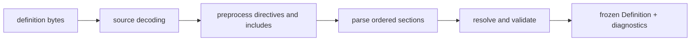

# oxtuner-ini

Parser and typed model for user-supplied ECU definition files.

The parser transforms definition bytes into a frozen `Definition` used by the
protocol, tune, simulator, and project crates. It is hand-written and has no
parser-generator dependency. Preprocessing, parsing, and validation are
separate stages so source locations and non-fatal diagnostics remain
available.

## Parse pipeline

1. `source` decodes bytes and handles a leading BOM.
2. `preprocess` resolves conditionals, definitions, settings, and
   caller-provided includes. An include name resolves from the caller's base
   directory, never from the including file's directory.
3. `parser` dispatches section entries into typed models while preserving
   source and document order.
4. Finalization resolves references and expressions and validates signatures,
   pages, and supported specification versions. A validation diagnostic names
   the file and local line of the entry it came from, including an entry that
   arrived through an include.

Structural problems return `IniError`. Recoverable entry-level problems are
stored as bounded `Diagnostic` values on the resulting definition. Unmodeled
sections remain available as unsupported data rather than being treated as
parse failures.

## Where to look

`src/source.rs`, `src/preprocess.rs`, and `src/settings.rs` cover the first two
stages. Section parsing and final checks are in `src/parser/`; the resulting
types are in `src/model/`. Command templates and expression handling live in
`src/fields.rs`, `src/expr.rs`, and `src/builtins.rs`.

Start with `parse_str` for text or `parse_bytes` for raw input.
`parse_str_with_includes` and `parse_str_with_source` expose include
resolution and source tracking.

Golden fixtures and property tests are in `tests/`. Run them with
`cargo nextest run -p oxtuner-ini`; `cargo bench -p oxtuner-ini` runs the parse
benchmark. Additional fuzz targets are documented in
[`fuzz/README.md`](./fuzz/README.md). Do not add real definition files to the
repository.

`oxtuner-protocol`, `oxtuner-tune`, `oxtuner-sim`, and `oxtuner-project`
consume this crate's models. `PARSER_VERSION` is a pinned cache key; discard
stale derived caches rather than adding version-gated migrations.
